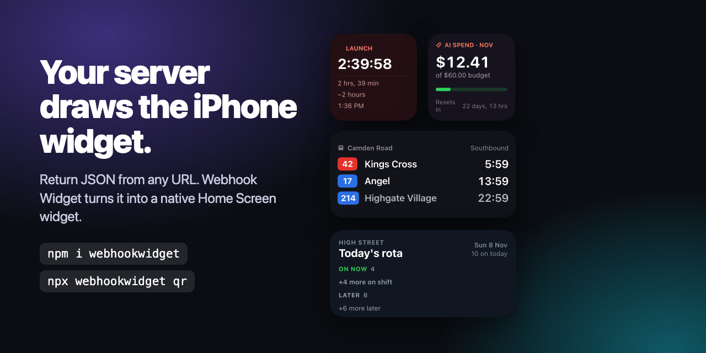

# Webhook Widget



[Webhook Widget](https://webhookwidget.com) turns any JSON endpoint into an iPhone widget. Your
server returns the whole layout, and the app draws it on the Home Screen and Lock Screen. You
do not need Xcode, a developer account or an account of any kind.

You need the app, on an iPhone or iPad with iOS 26.2 or later: [webhookwidget.com](https://webhookwidget.com).
Your own widgets are free for 7 days. After that, they need a one-time purchase. There is no
subscription. Widgets someone shares with you are always free.

This repository contains the developer tools:

| | |
| --- | --- |
| [`packages/webhookwidget`](packages/webhookwidget) | `npm i webhookwidget`: types for the payload, and `npx webhookwidget` for setup QR codes, links and previews. |
| [`templates/starter`](templates/starter) | A Cloudflare Worker that serves a widget, protected by a token. Deploys in one click. |

## Try one first

You do not need a server for this. Open the app, tap Add Hook and pick one of the examples
under "Or try some examples". webhookwidget.com serves the examples, and they work on your Home
Screen without the trial.

To test a setup QR code from your terminal, run the command below. Scan the code with the
iPhone camera and tap Save. A hook saved from a setup link is your own hook, so its widget needs
the trial or Premium.

```sh
npx webhookwidget qr --name "Hello" --url https://webhookwidget.com/demo/hello
```

## Make your own widget

[](https://deploy.workers.cloudflare.com/?url=https://github.com/smoothfrog/webhookwidget/tree/main/templates/starter)

1. Deploy the starter. When Cloudflare asks for `WIDGET_TOKEN`, choose a token.
2. Make a QR code for the endpoint. Scan the code with the iPhone camera.

   ```sh
   read -rs WIDGET_TOKEN && export WIDGET_TOKEN
   npx webhookwidget qr --name "My widget" --url https://my-widget.<your-subdomain>.workers.dev/ \
     --auth bearer --secret-env WIDGET_TOKEN
   ```

3. Tap Save in the app. Then put the widget on your Home Screen. Touch and hold the Home
   Screen. Tap Edit, then Add Widget. Search for Webhook Widget and add one. Touch and hold the
   new widget, tap Edit Widget, and choose your hook.

To show your own data, see [the starter's README](templates/starter#3-make-it-yours).

## Docs

- [Quickstart](https://webhookwidget.com/docs/quickstart/) and [the node reference](https://webhookwidget.com/docs/schema/)
- [The playground](https://webhookwidget.com/playground/), which draws a payload with the app's engine
- [llms.txt](https://webhookwidget.com/llms.txt), for coding agents
- [Worked examples](https://webhookwidget.com/examples/), each served live at `webhookwidget.com/demo/<id>`

## Questions and bugs

Open an [issue](https://github.com/smoothfrog/webhookwidget/issues), or email
[support@webhookwidget.com](mailto:support@webhookwidget.com).

MIT licensed. Webhook Widget is made by [Smooth Frog Ltd](https://smoothfrog.com).
